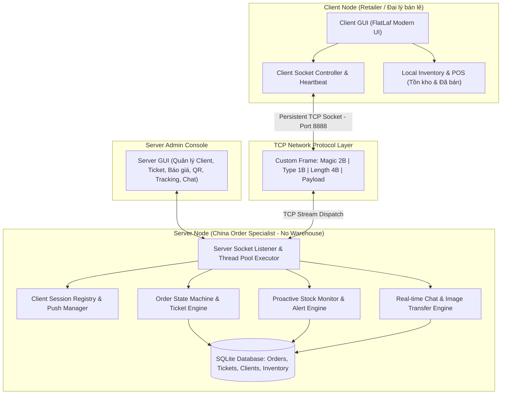
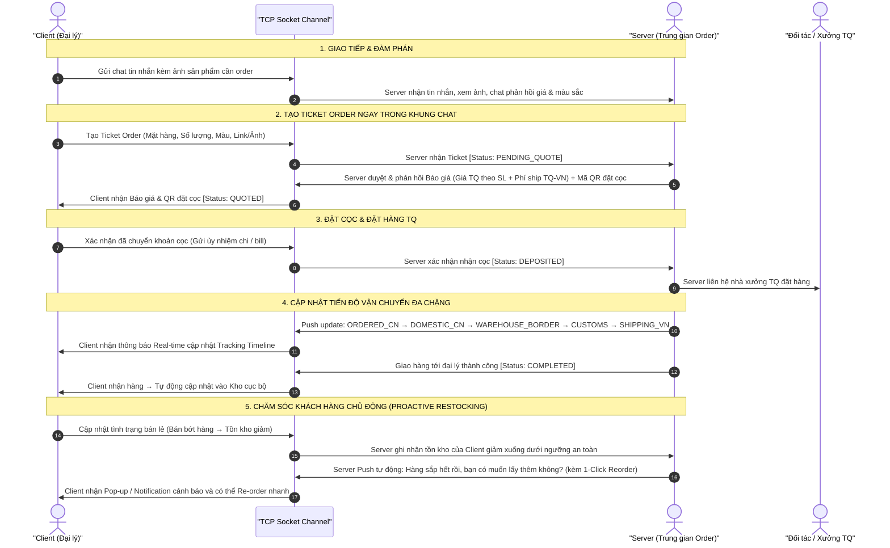

# Kế Hoạch Xây Dựng Hệ Thống Order Hàng Trung Quốc (Client/Server) - Lập Trình Mạng

## 1. Mục tiêu và Mô tả bài toán (Goal & Problem Description)

Xây dựng hệ thống mạng **Client/Server** chuyên biệt phục vụ mô hình kinh doanh **Order và Vận chuyển hàng Trung Quốc (China Order & Fulfillment System)** bằng ngôn ngữ **Java**. Hệ thống được thiết kế theo đúng định hướng trao đổi với giảng viên bộ môn và đáp ứng đầy đủ các tiêu chuẩn học thuật của môn học **Lập trình mạng (Network Programming 2026-2027)**:

- **Server (Người trung gian order & vận chuyển)**: Không sở hữu kho hàng vật lý (Zero Warehouse). Chịu trách nhiệm kết nối đầu mối nhà xưởng Trung Quốc, thương lượng giá/kích thước/màu sắc, tính toán chi phí vận chuyển, duyệt ticket order, tạo mã QR đặt cọc, cập nhật tiến độ vận chuyển đa chặng (TQ $\rightarrow$ VN) và **chủ động theo dõi tồn kho của Client để tư vấn/cảnh báo nhập hàng bổ sung**.
- **Client (Người bán lẻ / Đại lý tuyến dưới)**: Có kho hàng riêng để theo dõi số lượng tồn và đã bán; chat trực tiếp với Server để đàm phán; tạo Ticket order ngay trong khung chat; thanh toán cọc; theo dõi đơn hàng thời gian thực (tracking timeline); và tái đặt hàng nhanh (1-Click Reorder).
- **Trọng tâm Lập trình mạng**: Tự thiết kế Custom Application Protocol trên nền tảng **TCP Socket**, cơ chế đa luồng (**Multithreading & Thread Pool**), **Server Push Notification** thời gian thực, truyền nhận dữ liệu nhị phân (ảnh sản phẩm) tối ưu, chống dính gói/xé gói (packet framing), xử lý lỗi kết nối (Heartbeat / Auto-Reconnect) và kịch bản đo lường hiệu năng thực nghiệm (Latency, Throughput, Concurrency).

---

## 2. Các quyết định kỹ thuật cốt lõi (Key Technical Decisions)

### 2.1. Giao thức mạng (Network Protocol):

- Xây dựng **Custom Application Framing Protocol** trên nền **TCP Socket** thuần (cổng mặc định `8888`), không dùng framework web HTTP/Spring Boot để thể hiện đúng bản chất môn học Lập trình mạng.
- Cấu trúc gói tin nhị phân rõ ràng: `[Magic (2B)][Version (1B)][Type (1B)][Length (4B)][Payload]`, xử lý triệt để hiện tượng dính gói / xé gói trong TCP stream.

### 2.2. Giao diện người dùng (GUI):

- Sử dụng **Java Swing kết hợp giao diện hiện đại FlatLaf (Modern Dark/Light UI)**.
- Giúp ứng dụng giao diện trực quan, chuyên nghiệp, chạy trực tiếp trên Java 21 mà không bị lỗi thiếu môi trường JavaFX runtime khi nộp bài cho giảng viên.

### 2.3. Cơ sở dữ liệu & Lưu trữ (Persistence):

- Sử dụng **SQLite (qua JDBC)** hoặc bộ lưu trữ cục bộ Embedded JSON/Binary Engine.
- Tự động sinh file CSDL nội bộ (`server_database.db`, `client_store.db`), zero-configuration, giảng viên chỉ cần bấm chạy file JAR mà không cần cài đặt MySQL Server bên ngoài.

### 2.4. Điểm mới & Đóng góp kỹ thuật (Novelty & Contributions - Mục 7 & 16 trong Đề cương BTL):

1. **Proactive Inventory Monitoring & Restocking Push Engine**: Server liên tục giám sát ngưỡng tồn kho an toàn của đại lý và chủ động Push cảnh báo qua Socket thời gian thực ("Hàng sắp hết rồi, ông có muốn lấy thêm không?") kèm cơ chế 1-Click Re-order.
2. **Framed Length-Prefixed Binary/JSON Hybrid Protocol**: Giao thức tùy biến hỗ trợ truyền đồng thời bản tin điều khiển JSON và stream ảnh sản phẩm dung lượng lớn không gây nghẽn luồng socket.
3. **State Machine & Fault-Tolerant Reconnection**: Quản lý vòng đời đơn hàng chặt chẽ kèm cơ chế phục hồi phiên (session resume) khi mạng gián đoạn.

---

## 3. Kiến trúc hệ thống (System Architecture)



---

## 4. Quy trình nghiệp vụ cốt lõi (Core Business Flow)



---

## 5. Thiết kế chi tiết Giao thức ứng dụng (Custom Application Protocol)

### 5.1. Cấu trúc gói tin (Packet Framing):

```text
+----------------+----------------+----------------+--------------------------+-----------------------+
|  Magic Bytes   | Version (1B)   | Msg Type (1B)  | Payload Length (4 Bytes) | Payload Data (N Bytes)|
|  0x43 0x4E     | 0x01           | [Enum Type]    | [Big-Endian Integer]     | [JSON UTF-8 / Binary] |
+----------------+----------------+----------------+--------------------------+-----------------------+
```

- **Magic Bytes** (`0x43 0x4E` - chữ 'C', 'N'): Phân biệt gói tin hợp lệ và hủy các byte rác mạng.
- **Version** (`0x01`): Quản lý version giao thức.
- **Message Types**:
  - `0x01`: `AUTH_LOGIN_REQ` / `0x02`: `AUTH_LOGIN_RESP`
  - `0x10`: `CHAT_TEXT_MSG` (Tin nhắn văn bản)
  - `0x11`: `CHAT_IMAGE_MSG` (Truyền ảnh sản phẩm kèm metadata)
  - `0x20`: `TICKET_CREATE_REQ` (Client tạo ticket order)
  - `0x21`: `TICKET_QUOTE_RESP` (Server duyệt & gửi báo giá + mã QR đặt cọc)
  - `0x22`: `TICKET_DEPOSIT_CONFIRM` (Xác nhận nộp cọc)
  - `0x23`: `ORDER_STATUS_UPDATE` (Cập nhật chặng vận chuyển TQ $\rightarrow$ VN)
  - `0x30`: `INVENTORY_SYNC` (Đồng bộ số lượng tồn kho & hàng đã bán)
  - `0x31`: `RESTOCK_ALERT_PUSH` (Server push cảnh báo sắp hết hàng)
  - `0x40`: `REORDER_FAST_REQ` (Tái tạo ticket nhanh từ đơn cũ)
  - `0x90`: `PING` / `0x91`: `PONG` (Heartbeat giữ kết nối)
- **Payload Length (4 Bytes)**: Độ dài payload (big-endian).

---

## 6. Cấu trúc thư mục dự án chi tiết (Detailed Project Directory & Class Structure)

Hệ thống được tổ chức theo kiến trúc phân tầng rõ ràng (Layered Architecture), tuân thủ tuyệt đối quy định cấu trúc mã nguồn tại Mục 12 trong `Instruction.md`. Dưới đây là cây thư mục chi tiết đến từng file mã nguồn Java, cơ sở dữ liệu, scripts và tài liệu:

```text
assignment-network-project/
│
├── README.md                                  # Báo cáo kỹ thuật tóm tắt, hướng dẫn build, chạy và kết quả đo lường
├── China_order_system_plan.md                 # Bản kế hoạch chi tiết kiến trúc và phân công nhiệm vụ
│
├── Yêu cầu/                                   # Tài liệu đề bài và hướng dẫn của bộ môn Lập trình mạng
│   ├── Instruction.md                         # Quy chuẩn BTL Lập trình mạng 2026-2027
│   ├── Topics.md                              # Danh mục chủ đề bài tập lớn
│   ├── Submission.md                          # Hướng dẫn nộp bài, USB và định dạng file
│   ├── README.md                              # Mẫu README chuẩn của bộ môn
│   └── Trao đổi.txt                           # Biên bản yêu cầu nghiệp vụ thực tế từ Giảng viên
│
├── scripts/                                   # Bộ công cụ build và thực thi tự động (1-Click Execution)
│   ├── build.bat                              # Biên dịch toàn bộ source code với thư viện trong lib/
│   ├── run_server.bat                         # Khởi chạy Server Node (GUI + Socket Server Port 8888)
│   ├── run_client.bat                         # Khởi chạy Client Node (Giao diện Đại lý bán lẻ)
│   ├── run_benchmark.bat                      # Chạy kịch bản đo kiểm hiệu năng RTT và Throughput
│   └── clean.bat                              # Xóa các file class và file build tạm
│
├── lib/                                       # Các thư viện phụ trợ (.jar) nhúng sẵn trong đồ án
│   ├── flatlaf-3.5.jar                        # Giao diện Swing hiện đại FlatLaf (Dark/Light Theme)
│   ├── sqlite-jdbc-3.45.1.0.jar               # Trình điều khiển kết nối CSDL SQLite độc lập
│   └── gson-2.10.1.jar                        # Thư viện tuần tự hóa / giải tuần tự JSON nhanh
│
├── data/                                      # Thư mục dữ liệu và lưu trữ cục bộ
│   ├── schema_server.sql                      # Kịch bản DDL khởi tạo bảng cho Server DB
│   ├── schema_client.sql                      # Kịch bản DDL khởi tạo bảng kho hàng cục bộ cho Client
│   ├── server_storage.db                      # Tệp CSDL SQLite của Server (tự động tạo khi chạy)
│   ├── client_storage.db                      # Tệp CSDL SQLite của Client (tự động tạo khi chạy)
│   └── uploads/                               # Thư mục lưu trữ tạm các file ảnh sản phẩm truyền qua mạng
│
├── statics/                                   # Tài nguyên đồ họa, sơ đồ kiến trúc và kết quả thực nghiệm
│   ├── architecture.png                       # Sơ đồ khối kiến trúc hệ thống Client/Server
│   ├── protocol_flow.png                      # Sơ đồ tương tác gói tin TCP Custom Framing
│   ├── state_machine.png                      # Sơ đồ máy trạng thái vòng đời đơn hàng (Order Lifecycle)
│   └── benchmark_results/                     # Biểu đồ kết quả đo kiểm hiệu năng
│       ├── latency_vs_clients.png             # Đồ thị độ trễ RTT theo số lượng Client đồng thời
│       ├── throughput_comparison.png          # Đồ thị thông lượng gói tin (Throughput ops/sec)
│       └── push_vs_polling_delay.png          # Đồ thị so sánh độ trễ Server Push vs Polling
│
├── report/                                    # Thư mục chứa báo cáo bài tập lớn chính thức
│   └── NhomXX_ChinaOrderSystem_Report.docx    # Báo cáo IEEE format hoàn chỉnh nộp qua Compilatio
│
└── source/                                    # Toàn bộ mã nguồn Java của dự án
    │
    ├── common/                                # THƯ VIỆN DÙNG CHUNG GIỮA SERVER VÀ CLIENT
    │   │
    │   ├── protocol/                          # Phân tầng giao thức mạng (Custom Network Protocol)
    │   │   ├── Packet.java                    # Định nghĩa cấu trúc khung gói tin (Header + Payload)
    │   │   ├── PacketHeader.java              # Lớp đại diện 8 bytes tiêu đề (Magic, Ver, Type, Length)
    │   │   ├── MessageType.java               # Enum các loại mã lệnh (AUTH, CHAT, TICKET, RESTOCK...)
    │   │   ├── ProtocolFraming.java           # Bộ đọc/ghi dòng byte, chống dính gói & xé gói TCP
    │   │   └── ProtocolException.java         # Ngoại lệ xử lý lỗi giao thức (Invalid Magic/Malformed)
    │   │
    │   ├── model/                             # Các đối tượng dữ liệu nghiệp vụ (Business Entities)
    │   │   ├── User.java                      # Thông tin người dùng (ID, username, role, tên đại lý)
    │   │   ├── UserRole.java                  # Enum vai trò: SERVER_ADMIN, CLIENT_RETAILER
    │   │   ├── OrderTicket.java               # Thực thể Ticket order (Mã vé, tên hàng, mô tả, ảnh, link)
    │   │   ├── OrderStatus.java               # Enum 9 trạng thái: PENDING, QUOTED, DEPOSITED, ORDERED_CN...
    │   │   ├── PriceQuote.java                # Báo giá: đơn giá nhập TQ, tỷ giá, phí ship TQ-VN, tiền cọc
    │   │   ├── ChatMessage.java               # Cấu trúc tin nhắn chat (Người gửi, người nhận, text/ảnh, thời gian)
    │   │   ├── InventoryItem.java             # Mặt hàng trong kho đại lý (Mã SP, tên, tồn kho, đã bán, min_threshold)
    │   │   └── RestockAlert.java              # Thông điệp cảnh báo tồn kho sắp hết kèm đề xuất nhập
    │   │
    │   └── util/                              # Các tiện ích bổ trợ hệ thống
    │       ├── JsonUtil.java                  # Wrapper Gson chuyển đổi Object <-> JSON an toàn
    │       ├── ImageChunkUtil.java            # Cắt/ghép file ảnh thành các chunk nhị phân tối ưu qua TCP
    │       ├── QRCodeGenerator.java           # Sinh ảnh mã QR thanh toán đặt cọc (Chuẩn VietQR/Bank format)
    │       ├── ChecksumUtil.java              # Tính mã băm MD5/CRC32 xác thực tính toàn vẹn gói tin/ảnh
    │       └── LoggerUtil.java                # Ghi log chuẩn định dạng kèm timestamp và thread name
    │
    ├── server/                                # TOÀN BỘ MÃ NGUỒN PHÍA SERVER (NGƯỜI TRUNG GIAN ORDER)
    │   │
    │   ├── core/                              # Lõi xử lý mạng và quản lý đa luồng máy chủ
    │   │   ├── OrderServer.java               # Điểm khởi chạy ServerSocket (Port 8888), lắng nghe kết nối
    │   │   ├── ClientHandler.java             # Luồng Worker phục vụ từng kết nối Client (Runnable/Callable)
    │   │   ├── ClientSessionManager.java      # Quản lý danh bạ session Client đang online (ConcurrentHashMap)
    │   │   ├── ServerThreadPool.java          # Cấu hình ThreadPoolExecutor (Core Pool, Max Pool, Queue)
    │   │   └── ServerHeartbeatMonitor.java    # Quét định kỳ phát hiện client timeout, dọn socket chết
    │   │
    │   ├── service/                           # Lớp xử lý logic nghiệp vụ phía Server
    │   │   ├── OrderService.java              # Duyệt ticket, cập nhật trạng thái đơn hàng đa chặng
    │   │   ├── PricingService.java            # Tính toán bảng giá bậc thang theo số lượng & phí vận chuyển
    │   │   ├── ServerChatService.java         # Điều phối tin nhắn chat 1-1 và truyền nhận ảnh sản phẩm
    │   │   └── InventoryMonitorService.java   # NOVELTY 1: Giám sát tồn kho đại lý & tự động Push cảnh báo
    │   │
    │   ├── dao/                               # Tầng truy xuất dữ liệu CSDL SQLite của Server
    │   │   ├── DatabaseManager.java           # Khởi tạo kết nối SQLite, tự chạy schema DDL khi mở app
    │   │   ├── UserDao.java                   # Xác thực đăng nhập, danh sách đại lý đăng ký
    │   │   ├── OrderDao.java                  # CRUD Tickets, đơn hàng, lịch sử thay đổi trạng thái
    │   │   ├── ChatDao.java                   # Lưu trữ lịch sử tin nhắn và đường dẫn tệp ảnh
    │   │   └── ClientInventoryDao.java        # Lưu trữ bản sao số liệu tồn kho/đã bán của các đại lý
    │   │
    │   └── ui/                                # Giao diện đồ họa Server Admin Dashboard (FlatLaf Swing)
    │       ├── ServerMainFrame.java           # Cửa sổ chính Server với thanh điều hướng Tab chuyên nghiệp
    │       ├── ClientMonitorPanel.java        # Tab 1: Danh sách Client online & Bảng theo dõi tồn kho
    │       ├── TicketManagementPanel.java     # Tab 2: Tiếp nhận Ticket, duyệt báo giá & tạo mã QR cọc
    │       ├── OrderTrackingPanel.java        # Tab 3: Cập nhật chặng vận chuyển TQ-VN của từng đơn hàng
    │       ├── ServerChatPanel.java           # Tab 4: Cửa sổ Chat 1-1 với từng đại lý kèm hiển thị ảnh
    │       └── ServerLogPanel.java            # Tab 5: Bảng điều khiển Console hiển thị log mạng thời gian thực
    │
    ├── client/                                # TOÀN BỘ MÃ NGUỒN PHÍA CLIENT (ĐẠI LÝ BÁN LẺ)
    │   │
    │   ├── core/                              # Lõi kết nối mạng phía Client
    │   │   ├── OrderClient.java               # Điểm khởi động ứng dụng Client, khởi tạo kết nối
    │   │   ├── ClientSocketConnection.java    # Quản lý Socket TCP, luồng gửi gói tin (Sender Thread)
    │   │   ├── PacketListenerThread.java      # Luồng nền chuyên trách nhận gói tin từ Server (Dispatcher)
    │   │   ├── AutoReconnectManager.java      # NOVELTY 3: Tự động kết nối lại khi rớt mạng kèm khôi phục phiên
    │   │   └── ClientHeartbeatSender.java     # Luồng nền phát gói PING định kỳ (15s) giữ kết nối thông suốt
    │   │
    │   ├── service/                           # Lớp xử lý nghiệp vụ phía Client
    │   │   ├── ClientOrderService.java        # Tạo ticket order, gửi xác nhận cọc, theo dõi timeline
    │   │   ├── ClientChatService.java         # Gửi text, upload ảnh sản phẩm, nhận tin nhắn Server
    │   │   ├── ClientInventoryService.java    # Quản lý bán hàng, trừ tồn kho, đồng bộ dữ liệu lên Server
    │   │   └── FastReorderService.java        # Tiện ích tái tạo đơn hàng cũ nhanh chóng (1-Click Reorder)
    │   │
    │   ├── dao/                               # Bộ nhớ lưu trữ cục bộ của Đại lý (Local Cache/Storage)
    │   │   └── ClientLocalStore.java          # Lưu trữ SQLite kho hàng riêng và cache danh mục đơn đã đặt
    │   │
    │   └── ui/                                # Giao diện người dùng Client Application (FlatLaf Swing)
    │       ├── ClientMainFrame.java           # Cửa sổ chính của Đại lý với thanh công cụ điều hướng
    │       ├── ClientChatPanel.java           # Khung chat với Server, tích hợp nút "Tạo Ticket Order"
    │       ├── InChatTicketDialog.java        # Hộp thoại tạo ticket nhanh ngay trong màn hình chat
    │       ├── ClientOrderTimelinePanel.java  # Màn hình theo dõi hành trình đơn hàng (Visual 7-step Timeline)
    │       ├── DepositQRDialog.java           # Hộp thoại hiển thị mã VietQR đặt cọc và nút xác nhận đã nạp
    │       ├── RetailInventoryPanel.java      # Màn hình quản lý kho: ghi nhận bán lẻ, cập nhật tồn kho
    │       ├── RestockAlertNotification.java  # NOVELTY 1 UI: Toast / Pop-up thông báo khi Server cảnh báo hết hàng
    │       └── FastReorderDialog.java         # Hộp thoại xác nhận Reorder nhanh chỉ với 1 cú click
    │
    └── benchmark/                              # MÔ-ĐUN KIỂM THỬ VÀ THỰC NGHIỆM ĐO LƯỜNG HIỆU NĂNG MẠNG
        ├── ConcurrentClientSimulator.java     # Công cụ giả lập 10, 50, 100, 200 Client kết nối và gửi tải cùng lúc
        ├── LatencyThroughputTester.java       # Đo đạc Round-Trip Time (RTT), throughput gói tin/giây (ops/sec)
        ├── ImageTransferBenchmark.java        # Đo thời gian và thông lượng truyền tải ảnh (200KB - 2MB)
        ├── ServerPushVsPollingBenchmark.java  # Đo lường và chứng minh định lượng: Độ trễ Push (<15ms) vs Polling (3-5s)
        └── BenchmarkReportExporter.java       # Tự động xuất số liệu kiểm thử ra bảng dữ liệu và đồ thị phục vụ Báo cáo
```

---

### Chi tiết vai trò kỹ thuật của các gói thành phần (Package Breakdown):

| Tầng kiến trúc   | Tên Package        | Vai trò & Trách nhiệm chính trong hệ thống                                                                                                                                                 |
| :------------------ | :------------------ | :----------------------------------------------------------------------------------------------------------------------------------------------------------------------------------------------- |
| **Common**    | `common.protocol` | Đảm nhiệm toàn bộ cơ chế mã hóa, giải mã nhị phân, phân tích độ dài khung tin (Length-prefixed framing), giải quyết triệt để sự cố dính gói/xé gói của TCP socket. |
|                     | `common.model`    | Định nghĩa các thực thể dữ liệu dùng chung, trạng thái vòng đời đơn hàng và cấu trúc bản tin JSON trao đổi giữa hai máy.                                                |
|                     | `common.util`     | Cung cấp công cụ tuần tự hóa JSON, chia nhỏ file ảnh (chunking), tạo mã VietQR và kiểm tra tính toàn vẹn dữ liệu MD5.                                                           |
| **Server**    | `server.core`     | Quản lý vòng đời`ServerSocket`, cấp phát thread từ `ServerThreadPool` cho từng client, duy trì bảng hash session các client đang online để phục vụ Server Push.             |
|                     | `server.service`  | Xử lý logic đàm phán giá, tính cước vận chuyển, duyệt ticket, điều phối tin nhắn chat, và chạy giải thuật phân tích tồn kho để cảnh báo tự động.                   |
|                     | `server.dao`      | Thực thi các truy vấn SQL an toàn (PreparedStatements) vào CSDL SQLite lưu trữ trạng thái đơn, user và lịch sử chat.                                                               |
|                     | `server.ui`       | Cung cấp giao diện trực quan cho người điều hành Server: xem danh sách đại lý, chat, duyệt giá, tạo QR cọc và cập nhật từng chặng vận chuyển.                             |
| **Client**    | `client.core`     | Thiết lập kết nối TCP Socket tới Server, duy trì một luồng ngầm liên tục chờ nhận thông điệp, tự động kết nối lại khi mất mạng và gửi heartbeat ping.                  |
|                     | `client.service`  | Xử lý tạo ticket, nộp bill cọc, trừ kho khi bán lẻ hàng hóa, đồng bộ số liệu kho về Server và kích hoạt tính năng 1-Click Reorder.                                          |
|                     | `client.dao`      | Lưu trữ dữ liệu kho hàng nội bộ của riêng đại lý (đảm bảo tính bảo mật cục bộ của từng đại lý bán lẻ).                                                                |
|                     | `client.ui`       | Giao diện hiện đại cho đại lý: chat 1-1 đính kèm ảnh sản phẩm, theo dõi timeline tiến độ đơn hàng thời gian thực và nhận thông báo cảnh báo hết hàng.              |
| **Benchmark** | `benchmark`       | Đáp ứng yêu cầu thực nghiệm khoa học của học phần: giả lập tải đồng thời, đo đạc RTT, throughput và xuất bảng biểu so sánh kỹ thuật.                                  |

---

## 7. Kế hoạch Kiểm thử & Đo lường thực nghiệm (Benchmark Plan)

Xây dựng module `benchmark/` đáp ứng mục 8.11, 8.12 và 9 của đề cương BTL:

1. **Kiểm thử Đồng thời (Concurrent Client Scalability)**:
   - Giả lập từ $10 \rightarrow 200$ kết nối Client cùng lúc gửi yêu cầu Chat, tạo Ticket và đồng bộ kho hàng.
   - Thu thập: Tỷ lệ xử lý thành công (%), Tài nguyên tiêu thụ (CPU, RAM).
2. **Đo Độ trễ Phản hồi (End-to-End Latency / RTT)**:
   - Đo độ trễ từ lúc gửi ticket đến khi Server phản hồi.
   - So sánh định lượng giữa Server Push ($< 15\text{ms}$) và Client Polling ($2\text{s}-5\text{s}$).
3. **Hiệu năng Truyền tải Ảnh Sản phẩm (Throughput & Transfer Time)**:
   - Đo thời gian và thông lượng truyền file ảnh kích thước $200\text{KB} - 2\text{MB}$.
   - Xác thực tính toàn vẹn dữ liệu (Checksum MD5).

---

## 8. Lộ trình thực hiện chi tiết (Milestones)

|    Bước    | Nội dung triển khai                                                                                                                                  | Kết quả đầu ra                                                   |
| :----------: | :----------------------------------------------------------------------------------------------------------------------------------------------------- | :------------------------------------------------------------------- |
| **B1** | Chuẩn bị thư viện phụ trợ trong`lib/`, viết lớp `common.protocol` (Framing, Header, Packet, MessageType)                                   | Bộ protocol nền tảng, test đóng/mở gói dữ liệu thành công |
| **B2** | Xây dựng Server Core (`ServerSocket`, `ThreadPoolExecutor`, `ClientSessionManager`) & Client Core (`Socket`, Luồng nhận ngầm, Keep-alive) | Kết nối 2 chiều thông suốt, kiểm tra Ping-Pong                 |
| **B3** | Phát triển tính năng Chat 1-1 thời gian thực (Text + Binary Image Transfer) và kết nối CSDL SQLite                                            | Nhắn tin kèm hình ảnh mượt mà, lưu trữ lịch sử            |
| **B4** | Triển khai Ticket Order, Báo giá, sinh mã QR cọc và State Machine cập nhật tiến độ vận chuyển TQ$\rightarrow$ VN                        | Vòng đời đơn hàng hoạt động chính xác từ A đến Z       |
| **B5** | Triển khai Kho hàng Đại lý và Tính năng Novelty (Server Push cảnh báo hết hàng + 1-Click Re-order)                                         | Cảnh báo tự động đẩy về Client khi tồn kho thấp            |
| **B6** | Hoàn thiện giao diện đồ họa FlatLaf Swing cho Server và Client                                                                                  | 2 ứng dụng GUI hiện đại, đầy đủ chức năng                 |
| **B7** | Xây dựng công cụ Benchmark, chạy kịch bản đo kiểm, trích xuất biểu đồ số liệu thực nghiệm                                            | Số liệu thực nghiệm chuẩn khoa học                             |
| **B8** | Viết file`README.md` hoàn chỉnh và soạn thảo Báo cáo đồ án (Report Word) theo format quy định                                           | Đầy đủ tài liệu và mã nguồn sẵn sàng nộp bài            |

---

## 9. Bảng phân chia công việc cho 2 thành viên (Work Allocation for 2 Members)

Theo quy định mục 2 và 16 trong `Instruction.md`, dự án được phân chia cân đối giữa 2 thành viên ($50\% - 50\%$), mỗi người chịu trách nhiệm kỹ thuật cụ thể ở cả tầng mạng (Network Core), nghiệp vụ (Service), lưu trữ (Storage), giao diện (UI) và kiểm thử thực nghiệm (Benchmark).

### 9.1. Bảng phân công tổng quát

|     STT     | Thành viên             | Vai trò phụ trách chính                    | Các module và thành phần kỹ thuật chính                                                                                                                                                                                                                                                                                                                                                                                                                                                                                                                                                   |  Đóng góp  |
| :---------: | :----------------------- | :--------------------------------------------- | :----------------------------------------------------------------------------------------------------------------------------------------------------------------------------------------------------------------------------------------------------------------------------------------------------------------------------------------------------------------------------------------------------------------------------------------------------------------------------------------------------------------------------------------------------------------------------------------------- | :-----------: |
| **1** | **Thành viên 1 (Hiếu)** | **Server Core & Network Protocol Lead**  | - Custom TCP Socket Protocol Framing (Magic, Header, Length-prefixed).- Server Architecture, ServerSocket & ThreadPoolExecutor đa kết nối.- Client Session Registry & Cơ chế Server Push Notification thời gian thực.- Proactive Restocking Monitor Engine (Tính năng Novelty 1).- Thiết kế & triển khai SQLite Database Server (DAO, Schema, Orders, Tickets).- Giao diện Server Admin Dashboard (FlatLaf Swing).- Kiểm thử tải đồng thời (Concurrent Client Scalability Benchmark) & Viết báo cáo phần Server.                                                          | **50%** |
| **2** | **Thành viên 2 (Quang)** | **Client Core & Business Workflow Lead** | - Client Socket Controller & Luồng ngầm tiếp nhận gói tin (PacketListener).- Heartbeat Keep-Alive (Ping-Pong) & Fault-Tolerant Auto-Reconnect (Novelty 3).- Chunked Image Transfer Engine (Truyền nhận ảnh sản phẩm tối ưu - Novelty 2).- Local Inventory & POS Management (Quản lý kho cục bộ của đại lý).- In-Chat Ticket Creator & Order Lifecycle State Machine (Tracking 7 chặng).- Giao diện Client Application (Chat, Order, Timeline, Kho hàng, 1-Click Reorder).- Kiểm thử độ trễ phản hồi (End-to-End Latency Benchmark) & Viết báo cáo phần Client. | **50%** |

---

### 9.2. Ma trận phân chia chi tiết theo Module & File mã nguồn

| Module / Nhóm chức năng                                            | Thành phần chi tiết                                  |        Thành viên 1 phụ trách        |         Thành viên 2 phụ trách         | Trạng thái dự kiến |
| :-------------------------------------------------------------------- | :------------------------------------------------------ | :--------------------------------------: | :-----------------------------------------: | :--------------------: |
| **Tầng Giao thức mạng**(`common.protocol`)                 | `Packet.java`, `MessageType.java`                   | **Chính** (Thiết kế cấu trúc) |     Phối hợp (Tích hợp client type)     |           B1           |
|                                                                       | `ProtocolFraming.java` (Xử lý dính gói, xé gói) |             **Chính**             |            Phối hợp kiểm thử            |           B1           |
|                                                                       | Truyền file ảnh nhị phân & Metadata                 |        Phối hợp (Server decode)        | **Chính** (Client chunking & encode) |         B1, B3         |
| **Tầng Server Core**(`server.core`)                          | `OrderServer.java`, `ServerSocketListener`          |             **Chính**             |             Hỗ trợ tích hợp             |           B2           |
|                                                                       | `ClientHandler.java` (ThreadPoolExecutor)             |             **Chính**             |                      -                      |           B2           |
|                                                                       | `ClientSessionManager.java` (Push Registry)           |             **Chính**             |                      -                      |           B2           |
| **Tầng Client Core**(`client.core`)                          | `OrderClient.java`, `ClientSocketConnection`        |                    -                    |              **Chính**              |           B2           |
|                                                                       | `PacketListenerThread.java` (Bất đồng bộ)         |                    -                    |              **Chính**              |           B2           |
|                                                                       | `AutoReconnectHandler.java` & Keep-Alive Ping         |         Phối hợp (Server Pong)         | **Chính** (Client Ping & Reconnect) |           B2           |
| **Cơ sở dữ liệu & Model**(`common.model`, `server.dao`) | Data Models (`User`, `OrderTicket`, `Inventory`)  |                Phối hợp                |                 Phối hợp                 |           B1           |
|                                                                       | `DatabaseManager.java`, SQLite JDBC, DAOs             |             **Chính**             |                      -                      |           B3           |
|                                                                       | Client Local Cache / SQLite Storage                     |                    -                    |              **Chính**              |           B5           |
| **Nghiệp vụ Chat & Đàm phán**                              | Chat Text 1-1 qua TCP Socket                            |       Phối hợp (Server routing)       |       Phối hợp (Client gửi/nhận)       |           B3           |
|                                                                       | Truyền & hiển thị ảnh sản phẩm trong chat         |                Phối hợp                |              **Chính**              |           B3           |
| **Nghiệp vụ Order & Tracking**                                | Tạo Ticket Order trong khung chat                      |     Phối hợp (Server tiếp nhận)     |     **Chính** (UI & Ticket Form)     |           B4           |
|                                                                       | Duyệt giá, tính phí vận chuyển & tạo mã QR cọc |             **Chính**             |        Phối hợp (Client nạp cọc)        |           B4           |
|                                                                       | State Machine hành trình đơn hàng (7 chặng)       |   **Chính** (Cập nhật chặng)   |   **Chính** (Tracking Timeline UI)   |           B4           |
| **Tính năng Novelty (Điểm mới)**                           | Proactive Inventory Alerting Engine (Server Push)       |             **Chính**             |           Phối hợp (Nhận push)           |           B5           |
|                                                                       | 1-Click Fast Reorder từ đơn cũ                      |     Phối hợp (Xử lý đơn mới)     |     **Chính** (UI & sinh ticket)     |           B5           |
| **Giao diện người dùng**(`server.ui`, `client.ui`)      | Server Admin Dashboard (FlatLaf Swing)                  |             **Chính**             |                      -                      |           B6           |
|                                                                       | Client App: Chat, Order, Tracking, Kho hàng            |                    -                    |              **Chính**              |           B6           |
| **Thực nghiệm & Đo lường**(`benchmark`)                  | `ConcurrentClientSimulator.java` (50-200 clients)     |             **Chính**             |                 Phối hợp                 |           B7           |
|                                                                       | `LatencyThroughputTester.java` (RTT, Image speed)     |                Phối hợp                |              **Chính**              |           B7           |
| **Tài liệu & Báo cáo**                                      | Viết`README.md` & Hướng dẫn cài đặt/chạy      |             **Chính**             |                 Phối hợp                 |           B8           |
|                                                                       | Soạn thảo Báo cáo BTL (Report Word IEEE format)     |  Phụ trách Phần 1, 3, 4, 5, 8.1-8.9  |    Phụ trách Phần 2, 6, 7, 8.10-8.19    |           B8           |
|                                                                       | Kiểm tra độ tương đồng Compilatio ($\le 20\%$) |            Đồng phụ trách            |             Đồng phụ trách             |           B8           |
